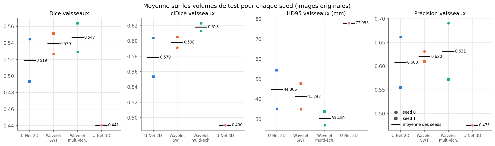
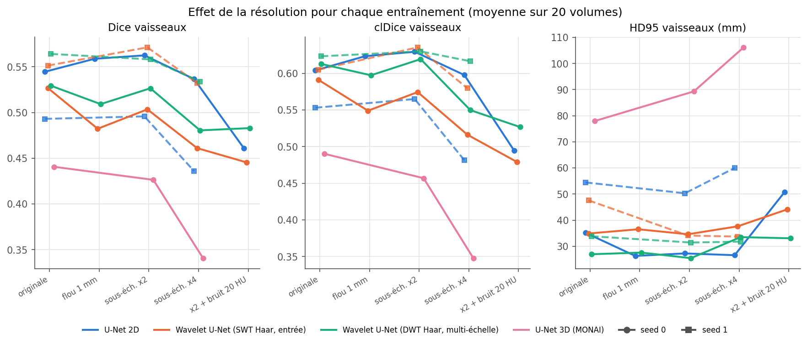
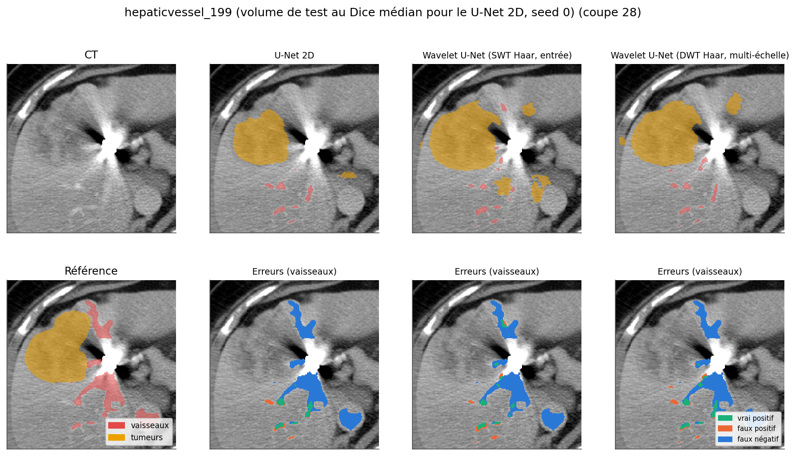
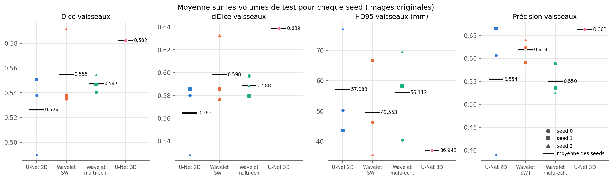
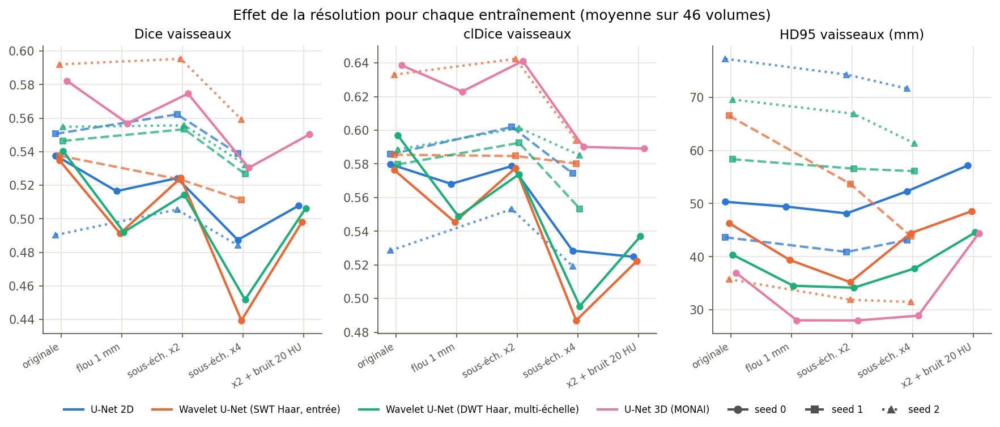

# Segmentation des vaisseaux hépatiques par Deep Learning et ondelettes

Wavelet-Guided Hepatic Vessel Segmentation : segmentation des vaisseaux hépatiques par Deep
Learning et analyse multi-échelles en ondelettes.

## Présentation

Dans ce projet, j'ai étudié la segmentation automatique des vaisseaux sanguins du foie sur des
images CT, à partir du jeu de données Task08_HepaticVessel du Medical Segmentation Decathlon. J'ai
comparé un U-Net 2D classique à deux variantes qui reçoivent en plus des caractéristiques issues de
transformées en ondelettes, puis j'ai étudié le comportement de ces modèles quand la résolution des
images diminue, en m'intéressant particulièrement aux petits vaisseaux.

Il s'agit d'un projet académique personnel. U-Net et les ondelettes sont des méthodes existantes ;
ma contribution est l'implémentation complète du pipeline et l'étude comparative.

## Objectifs

Question de recherche : l'utilisation de caractéristiques multi-échelles extraites par
transformée en ondelettes permet-elle d'améliorer la segmentation des vaisseaux hépatiques par
rapport à un U-Net standard ?

Pour y répondre, j'ai :

- développé un U-Net 2D de référence et deux variantes guidées par ondelettes ;
- entraîné les trois modèles dans des conditions identiques (mêmes patches, mêmes augmentations,
  mêmes hyperparamètres) ;
- évalué les modèles par volume sur un ensemble de test séparé au niveau patient, avec des
  métriques de recouvrement, de surface (HD95) et de topologie (clDice) ;
- mesuré leur robustesse à des images artificiellement dégradées ;
- analysé la détection des vaisseaux selon leur calibre.

En résumé, sur CPU (40 volumes d'entraînement, deux seeds) puis sur GPU (212 volumes, trois
seeds), les ondelettes n'ont pas apporté d'amélioration robuste du Dice : le sens de la différence
avec le U-Net change d'une seed à l'autre. Sur GPU, les deux variantes ondelettes se sont montrées
moins robustes que le U-Net standard à une forte baisse de résolution, pour les trois seeds. Quand la
résolution baisse, tous les modèles perdent d'abord les vaisseaux de moins de 1,5 mm de rayon. Le
meilleur modèle obtenu est le U-Net 3D entraîné sur GPU avec tous les cas (Dice 0,582, clDice
0,639 sur 46 volumes de test).

## Jeu de données

Medical Segmentation Decathlon, tâche 8 (Hepatic Vessel) : 303 scanners CT annotés et 140 non
annotés, provenant du Memorial Sloan Kettering Cancer Center, sous licence CC-BY-SA 4.0. Les masques
contiennent trois labels : fond (0), vaisseaux (1) et tumeur (2). Toutes les coupes font 512 x 512
pixels, mais l'espacement varie selon les patients (0,57 à 0,98 mm dans le plan, 0,8 à 8 mm entre
les coupes).

J'ai séparé les 303 cas annotés en entraînement, validation et test (70 / 15 / 15 %, seed 42) au
niveau du patient. Sur CPU, faute de GPU et à cause d'une connexion lente, j'ai utilisé un
sous-ensemble de 68 cas : 40 pour l'entraînement, 8 pour la validation et 20 pour le test. Ces cas
ont été téléchargés individuellement depuis l'archive officielle, grâce à des requêtes HTTP
partielles sur le fichier tar (sans télécharger les 9,3 Go). Sur GPU (Kaggle), j'ai repris la même
séparation avec tous les cas : 212 / 45 / 46. Les 20 volumes de test CPU font partie des 46.

Détails et statistiques : [docs/donnees.md](docs/donnees.md) et
[notebooks/01_exploration.ipynb](notebooks/01_exploration.ipynb).

## Méthodologie

Prétraitement : réorientation en RAS+ sans interpolation, vérification de l'alignement image /
masque et des labels, normalisation des HU (troncature aux percentiles 0,5 - 99,5 des voxels annotés
de l'entraînement puis centrage-réduction), pas de rééchantillonnage dans le plan pour ne pas
dégrader les vaisseaux fins des masques.

Modèles, tous entraînés sur des patches 2D de 192 x 192 :

- U-Net 2D (Ronneberger et al., 2015), 5 étages de 16 à 256 filtres, 1,94 M de paramètres ;
- Wavelet U-Net « entrée » : la coupe CT et ses 4 sous-bandes de Haar (LL, LH, HL, HH) issues de la
  transformée stationnaire, de même taille que l'image, forment une entrée à 5 canaux ;
- Wavelet U-Net « multi-échelle » : les sous-bandes de la DWT de Haar aux niveaux 1 et 2 (H/2 et
  H/4) sont concaténées aux caractéristiques des étages correspondants de l'encodeur.

Les ondelettes sont calculées avec PyWavelets en prétraitement (elles ne sont ni apprises ni
différentiables) et ne sont jamais appliquées aux masques. Perte Dice + cross-entropy, AdamW,
décroissance cosinus, early stopping et choix du meilleur modèle sur le Dice des vaisseaux en
validation.

Évaluation par volume : Dice, IoU, précision, rappel, F1, HD95 (en mm, avec l'espacement réel),
clDice, rappel de la ligne centrale par classe de rayon et analyse des composantes connexes.

Détails : [docs/methodologie.md](docs/methodologie.md) et
[notebooks/02_wavelet_analysis.ipynb](notebooks/02_wavelet_analysis.ipynb).

## Expériences

Les expériences 1 à 6 ont été lancées sur le CPU d'un ordinateur portable (Intel Core i5-1135G7,
sans GPU), la 7 sur un GPU Kaggle ; le déroulé complet est dans
[docs/rapport_experiences.md](docs/rapport_experiences.md).

1. Inspection des données et analyse des sous-bandes ondelettes (décomposition, reconstruction,
   amplitude dans et autour des vaisseaux).
2. Entraînement des trois modèles 2D avec deux seeds (0 et 1), dans des conditions identiques :
   patches de 192 x 192, 960 patches par époque, 25 époques au plus, early stopping sur le Dice des
   vaisseaux en validation (jamais avant 12 époques). Une troisième seed a été commencée puis
   abandonnée faute de temps de calcul.
3. Évaluation sur les 20 volumes de test, par volume, sur les images originales.
4. Étude de la résolution : les images de test sont floutées (1 mm), sous-échantillonnées d'un
   facteur 2 ou 4, ou sous-échantillonnées d'un facteur 2 et bruitées (20 HU), puis ramenées à la grille
   d'origine. Toutes les conditions pour la seed 0 ; facteurs 2 et 4 pour la seed 1.
5. Extension 3D : U-Net 3D de MONAI entraîné une fois (seed 0) par patches de 16 x 128 x 128.
6. Extension facultative : recalage SimpleITK sur des transformations synthétiques connues.
7. Reprise sur GPU (Kaggle, Tesla T4, notebook [05](notebooks/05_kaggle_gpu.ipynb)) avec tous les
   cas annotés : trois modèles 2D x trois seeds, mêmes architectures et mêmes réglages de base,
   4 000 patches par époque, puis un U-Net 3D plus grand (patches de 24 x 160 x 160, 60 époques).
   Évaluation sur les 46 volumes de test, dans les mêmes conditions que sur CPU. Durée : 5,7 h.

## Résultats

### Sur CPU (40 / 8 / 20 cas, deux seeds)

Vaisseaux, 20 volumes de test, images originales, moyenne sur les volumes
(`results/metrics/test_per_seed.csv`) :

| Modèle | Seed | Dice | clDice | HD95 (mm) | Précision | Rappel |
|---|---|---|---|---|---|---|
| U-Net 2D | 0 | 0,545 | 0,604 | 35,2 | 0,661 | 0,527 |
| U-Net 2D | 1 | 0,493 | 0,553 | 54,5 | 0,554 | 0,552 |
| Wavelet U-Net, SWT en entrée | 0 | 0,527 | 0,591 | 34,9 | 0,631 | 0,541 |
| Wavelet U-Net, SWT en entrée | 1 | 0,551 | 0,605 | 47,6 | 0,609 | 0,590 |
| Wavelet U-Net, DWT multi-échelle | 0 | 0,529 | 0,613 | 27,0 | 0,691 | 0,519 |
| Wavelet U-Net, DWT multi-échelle | 1 | 0,564 | 0,623 | 33,8 | 0,571 | 0,635 |
| U-Net 3D (MONAI) | 0 | 0,441 | 0,490 | 78,0 | 0,475 | 0,488 |

Ce que j'en retiens :

- **Pas de gain robuste des ondelettes sur le Dice.** Avec la seed 0, le U-Net est légèrement
  meilleur (différences non significatives) ; avec la seed 1, les deux variantes ondelettes le
  dépassent sur 17 ou 18 volumes sur 20. L'écart entre les deux entraînements du U-Net (0,052) est
  plus grand que les écarts entre modèles. Les tests de Wilcoxon sur les volumes
  (`results/metrics/test_wilcoxon_vs_unet2d.csv`) sont donc à lire seed par seed : ils ne prennent
  pas en compte la variabilité entre entraînements.
- **Un effet de même sens pour les deux seeds** : la variante multi-échelle réduit le HD95
  (- 8,2 mm, p = 0,03 pour la seed 0 ; - 20,6 mm, p = 0,0003 pour la seed 1) et produit moins de
  composantes isolées sans recouvrement avec la référence. Avec deux seeds seulement, c'était une
  piste : elle ne s'est pas confirmée sur GPU (voir plus bas).
- **Les petits vaisseaux sont le point faible de tous les modèles** : le rappel de la ligne centrale
  est de 0,43 à 0,57 pour un rayon local inférieur à 1,5 mm, contre 0,72 à 0,82 entre 1,5 et 3 mm.
- **Résolution** : un flou de 1 mm ou un facteur 2 changent peu les résultats. Au facteur 4, le Dice
  des modèles 2D baisse de 1,5 à 12,5 % selon le modèle et la seed, et ce sont surtout les vaisseaux
  de moins de 1,5 mm qui disparaissent (rappel de la ligne centrale de 0,27 à 0,41). L'ordre des
  modèles en robustesse change avec la seed : les ondelettes de Haar ne protègent pas
  systématiquement les structures fines. L'analyse des sous-bandes montre que les détails de
  niveau 1 portent surtout le bruit et disparaissent presque sur les images dégradées.
- **U-Net 3D** : nettement en dessous des modèles 2D dans ce budget de calcul (un seul entraînement,
  petits patches), avec beaucoup de faux positifs, et le moins robuste au facteur 4 (- 23 %).
- **Tumeurs** : mal segmentées par tous les modèles (Dice de 0,17 à 0,33), qui ont été sélectionnés
  sur les vaisseaux.
- **Recalage synthétique** : l'erreur moyenne sur des points des vaisseaux passe de 9 à 11 mm à
  moins de 0,4 mm pour des transformations de translation, rigide et affine connues.







### Sur GPU (Kaggle, 212 / 45 / 46 cas, trois seeds)

Vaisseaux, 46 volumes de test, moyenne sur les volumes puis moyenne et écart-type sur les seeds
(`results/kaggle/metrics/test_per_seed.csv`). La dernière colonne donne le Dice au facteur 4
rapporté au Dice sur les images originales :

| Modèle | Dice (seeds 0 / 1 / 2) | Dice moyen | clDice | HD95 (mm) | Dice relatif x4 |
|---|---|---|---|---|---|
| U-Net 2D | 0,538 / 0,551 / 0,490 | 0,526 ± 0,032 | 0,565 ± 0,031 | 57,1 ± 17,8 | 0,91 / 0,98 / 0,99 |
| Wavelet U-Net, SWT en entrée | 0,535 / 0,538 / 0,592 | 0,555 ± 0,032 | 0,598 ± 0,030 | 49,6 ± 15,7 | 0,82 / 0,95 / 0,94 |
| Wavelet U-Net, DWT multi-échelle | 0,540 / 0,546 / 0,555 | 0,547 ± 0,007 | 0,588 ± 0,009 | 56,1 ± 14,7 | 0,84 / 0,96 / 0,96 |
| U-Net 3D (MONAI, une seed) | 0,582 | 0,582 | 0,639 | 36,9 | 0,91 |

Ce que j'en retiens :

- **Plus de données aide peu les modèles 2D.** Sur les 20 volumes de test communs avec le CPU, le
  Dice moyen passe de 0,519 à 0,538 pour le U-Net, de 0,539 à 0,563 pour la variante SWT et de
  0,547 à 0,551 pour la variante multi-échelle. Le U-Net 3D, lui, passe de 0,441 à 0,591.
- **Toujours pas de gain robuste des ondelettes.** Seed 0 : pas de différence de Dice (p = 0,75 et
  0,86). Seed 1 : variantes ondelettes un peu moins bonnes (SWT - 0,013, p = 0,01). Seed 2 :
  nettement meilleures, mais parce que l'entraînement du U-Net de cette seed est mauvais (précision
  0,39). La variante multi-échelle est la plus stable d'une seed à l'autre. L'avantage de HD95 vu sur
  CPU ne se confirme pas (seed 1 : + 14,7 mm par rapport au U-Net).
- **Les ondelettes rendent les modèles moins robustes à la résolution.** Au facteur 4, le U-Net 2D
  garde 91 à 99 % de son Dice, les variantes ondelettes 82 à 96 %, et c'est moins que le U-Net de
  même seed pour chacune des trois seeds. Même tendance avec le flou de 1 mm (seed 0). C'est
  cohérent avec l'analyse des sous-bandes : sur une image dégradée, les canaux de détail changent
  fortement de distribution par rapport à l'entraînement.
- **Le U-Net 3D est le meilleur modèle** (Dice 0,582, clDice 0,639, HD95 36,9 mm), meilleur que le
  U-Net 2D de même seed sur 36 volumes sur 46 (p < 0,001). Il n'a été entraîné qu'une fois, et sa
  meilleure époque est la 56e sur 60 : un entraînement plus long pourrait encore l'améliorer.
- **Petits vaisseaux** : le rappel de la ligne centrale pour un rayon inférieur à 1,5 mm va de 0,32
  à 0,59 selon le modèle et la seed, et tombe à 0,22-0,41 au facteur 4.





Les autres figures (données, sous-bandes, courbes d'apprentissage, rappel par calibre, rendu 3D,
cas difficiles, recalage) sont dans `results/figures/` et `results/kaggle/figures/`, et commentées
dans les notebooks [02](notebooks/02_wavelet_analysis.ipynb) et
[03](notebooks/03_model_comparison.ipynb).

## Installation

Le projet a été développé et testé avec Python 3.10 sous Windows 11, sur CPU (Intel Core i5 de
11e génération, 16 Go de RAM, sans GPU NVIDIA). Il ne dépend que de bibliothèques Python et
fonctionne aussi sous Linux ou WSL.

```bash
python -m venv .venv
source .venv/bin/activate          # Windows : .venv\Scripts\activate
pip install torch==2.8.0 --index-url https://download.pytorch.org/whl/cpu   # sans GPU
pip install -r requirements.txt
python scripts/check_environment.py
python -m pytest
```

Sous Windows, si SimpleITK refuse de se charger (« The filename or extension is too long »), il faut
créer l'environnement dans un dossier au chemin plus court.

## Exécution

Toutes les étapes lisent un fichier de configuration YAML (`configs/`).

```bash
# Données : séparation au niveau patient, téléchargement du sous-ensemble, prétraitement
python scripts/download_data.py --config configs/data.yaml
python scripts/prepare_data.py --config configs/data.yaml
python scripts/inspect_dataset.py --config configs/data.yaml
python scripts/wavelet_analysis.py --config configs/data.yaml

# Entraînement (puis la même chose avec --seed 1)
python scripts/train.py --config configs/unet_2d.yaml --seed 0
python scripts/train.py --config configs/wavelet_unet.yaml --seed 0
python scripts/train.py --config configs/wavelet_unet_multiscale.yaml --seed 0

# Évaluation sur le test : seed 0 dans les 5 conditions, puis seed 1 et U-Net 3D
python scripts/evaluate.py --config configs/evaluation.yaml
python scripts/evaluate.py --config configs/evaluation.yaml --conditions original down_x2 down_x4 \
    --runs experiments/unet2d_seed1 experiments/wavelet_unet_swt_haar_seed1 \
           experiments/wavelet_unet_dwt_haar_ms_seed1 experiments/unet3d_seed0
python scripts/analyze_results.py --split test

# Segmentation d'un nouveau volume
python scripts/predict.py --run experiments/unet2d_seed0 --input volume.nii.gz --output masque.nii.gz --png

# Extensions
python scripts/train.py --config configs/unet_3d.yaml --seed 0
python scripts/registration_demo.py
```

`scripts/run_all.sh` enchaîne l'ensemble. Pour le GPU, le notebook
[05_kaggle_gpu.ipynb](notebooks/05_kaggle_gpu.ipynb) relance la comparaison sur Kaggle avec tous les
cas annotés (212 / 45 / 46) et trois seeds par modèle. Il appelle `scripts/run_kaggle.py`, qui
applique un budget de temps adapté aux sessions de 12 h et reprend là où il s'est arrêté ; les
réglages GPU sont dans `configs/kaggle/` et les résultats dans `results/kaggle/`, séparés des
résultats CPU. Le notebook [04](notebooks/04_entrainement_gpu_colab.ipynb) est une version plus
simple pour Google Colab.

Organisation du dépôt :

```
configs/        fichiers YAML (données, modèles, évaluation) ; configs/kaggle/ pour le GPU
src/data/       lecture des NIfTI, séparation au niveau patient, Dataset PyTorch, téléchargement partiel
src/preprocessing/  normalisation, augmentations, dégradations de résolution
src/wavelets/   transformées en ondelettes (DWT, SWT) et normalisation des sous-bandes
src/models/     U-Net 2D et variantes ondelettes, U-Net 3D (MONAI)
src/training/   pertes, boucles d'entraînement 2D et 3D
src/evaluation/ inférence, métriques, analyse des vaisseaux, évaluation multi-modèles
src/visualization/  figures
src/registration/   recalage SimpleITK sur transformations synthétiques
scripts/        points d'entrée en ligne de commande
notebooks/      exploration, ondelettes, comparaison des modèles, entraînement GPU
tests/          tests unitaires et d'intégration (pytest)
results/        métriques (CSV) et figures obtenues sur CPU ; results/kaggle/ pour le GPU
experiments/    configurations et historiques d'entraînement (checkpoints non versionnés) ;
                experiments/kaggle/ pour le GPU
docs/           données, méthodologie, rapport d'expériences
references/     références bibliographiques
```

## Limites

- **Puissance statistique** : deux seeds sur CPU et trois sur GPU ne suffisent pas pour séparer
  complètement l'effet du modèle de la variabilité entre entraînements, qui reste du même ordre que
  les écarts entre modèles 2D. Il faudrait au moins 5 seeds par modèle.
- **Capacité des modèles 2D** : le U-Net est volontairement réduit (16 filtres au premier étage)
  pour tenir sur CPU, et les mêmes architectures ont été gardées sur GPU pour comparer à l'identique.
  Avec 212 volumes, ces modèles atteignent leur meilleur Dice de validation dès 5 à 16 époques et
  gagnent peu par rapport à 40 volumes : leur taille limite probablement les résultats. Les scores
  restent en dessous des meilleures méthodes publiées sur ce jeu de données.
- **Sélection des modèles** : la validation porte sur 8 volumes (CPU) ou 45 volumes (GPU), une coupe
  sur trois ou sur deux ; elle reste bruitée d'une époque à l'autre.
- **Annotations** : certaines branches fines visibles ne semblent pas annotées, ce qui pénalise les
  modèles qui les segmentent et rend le rappel des petits vaisseaux difficile à interpréter.
- **Anisotropie** : la plupart des volumes ont des coupes de 5 mm. Les modèles 2D traitent les coupes
  indépendamment, et le clDice comme l'analyse des composantes sont calculés sur une grille très
  anisotrope.
- **Dégradations simulées** : flou et sous-échantillonnage dans le plan uniquement, appliqués à des
  images déjà reconstruites. Ce ne sont ni de vraies acquisitions à une autre résolution, ni des
  données micro-CT. Les modèles n'ont pas été entraînés avec ce type d'augmentation.
- **Ondelettes** : seules Haar (SWT niveau 1 et DWT niveaux 1-2) ont été entraînées ; les
  statistiques de db2 sont calculées mais ce modèle n'a pas été entraîné. Les transformées sont
  fixes (PyWavelets), sans couche ondelette apprise ou différentiable.
- **U-Net 3D** : un seul entraînement sur CPU et un seul sur GPU ; le modèle 3D n'existe pas en
  version ondelettes. Sa supériorité sur les modèles 2D est nette, mais ce n'est pas une
  comparaison 2D / 3D aboutie (une seule seed, réglages différents).
- **Interruptions** : la machine s'est mise en veille plusieurs fois pendant les calculs CPU. Cela
  n'a pas d'effet sur les résultats (les processus reprennent à l'identique), mais les durées brutes
  des fichiers `summary.json` incluent ces périodes. Un premier lancement sur Kaggle a échoué faute
  du dossier `src/data` sur GitHub (voir le rapport) ; seul le second lancement est utilisé.

Pistes d'amélioration : plusieurs seeds pour le U-Net 3D et une variante 3D guidée par ondelettes,
des modèles 2D plus larges, une augmentation de données par dégradation de la résolution (qui
pourrait corriger la fragilité des variantes ondelettes), une couche DWT différentiable intégrée au
réseau, des ondelettes à support plus long (db2, db4) et un post-traitement limitant les
prédictions au foie.

## Références

Les références complètes sont dans [references/references.md](references/references.md).
Principales sources :

- Simpson et al. (2019), *A large annotated medical image dataset for the development and
  evaluation of segmentation algorithms*, arXiv:1902.09063, et Antonelli et al. (2022), *The Medical
  Segmentation Decathlon*, Nature Communications : données.
- Ronneberger et al. (2015), *U-Net*, MICCAI ; Çiçek et al. (2016), *3D U-Net*, MICCAI.
- Isensee et al. (2021), *nnU-Net*, Nature Methods : normalisation CT et perte Dice + CE.
- Shit et al. (2021), *clDice*, CVPR : métrique topologique.
- Mallat (1989) ; Nason et Silverman (1995) : DWT et transformée stationnaire.
- PyTorch, MONAI, PyWavelets, NiBabel, SimpleITK, scikit-image.
- Projet de départ (segmentation cardiaque CT par U-Net, dépôts GitHub d'AhmedIbrahimai), utilisé
  seulement comme référence pour les étapes générales ; aucun code n'en a été repris.

## Licence des figures

Les données du Medical Segmentation Decathlon (Task08_HepaticVessel, Memorial Sloan Kettering
Cancer Center) sont distribuées sous licence
[CC BY-SA 4.0](https://creativecommons.org/licenses/by-sa/4.0/). Les figures de `results/figures/`
et des notebooks qui montrent des images CT ou des masques de ce jeu de données en sont dérivées :
elles sont soumises à la même licence CC BY-SA 4.0, avec attribution au Medical Segmentation
Decathlon (Simpson et al., 2019 ; Antonelli et al., 2022).
